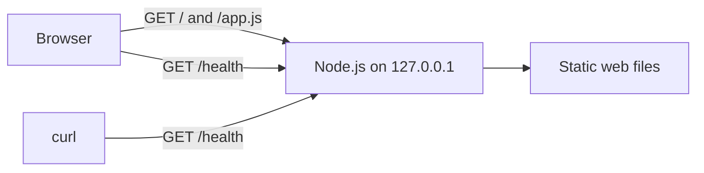
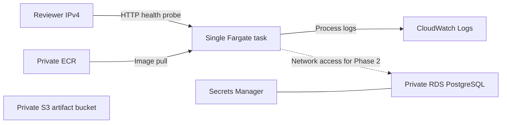

# Architecture

The local foundation is a small app that exercises the test infrastructure.

The HTTP adapter in `apps/api/server.js` starts the process and writes HTTP responses. The route function in `apps/api/app.js` chooses the status, headers, and body. Unit tests call it directly without opening a socket. The setup and teardown scripts manage the single process for interactive development.

The frontend requests `/health` on page load and on demand. The health response confirms that the service can answer requests. Phase 0 has no external dependencies to check. The API serves only explicitly mapped web files, and local configuration stays outside the public routes.

## AWS demo configuration

Terraform defines the resources and dependency order. The Fargate task runs the same HTTP server as the local workflow. Its IP can change when ECS replaces it. The database and artifact bucket are provisioned for the demo and are unused by the health route. A local Kubernetes cluster will provide the Kubernetes proof without an EKS control plane. See the [AWS runbook](infra/terraform/README.md) for deployment and teardown.
