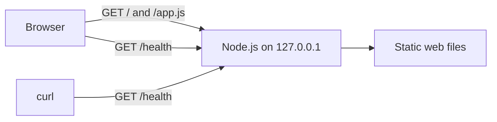
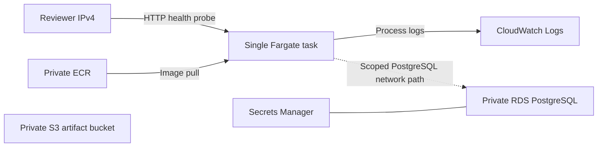
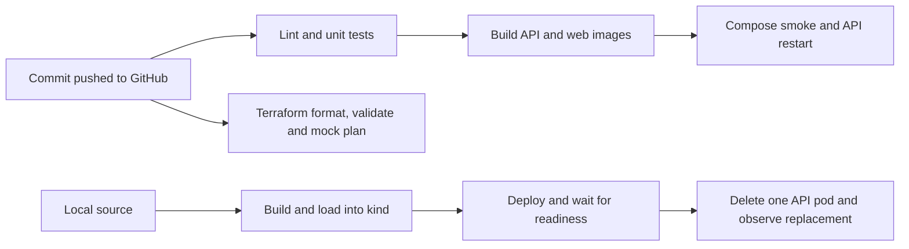

# Architecture

The local foundation is a small app that exercises the test infrastructure.

The HTTP adapter in `apps/api/server.js` starts the process and writes HTTP responses. The route function in `apps/api/app.js` chooses the status, headers, and body. Unit tests call it directly without opening a socket. The setup and teardown scripts manage the single process for interactive development.

The frontend requests `/health` on page load and on demand. The health response confirms that the service can answer requests. Phase 0 has no external dependencies to check. The API serves only explicitly mapped web files, and local configuration stays outside the public routes.

## AWS demo configuration

Terraform defines the resources and dependency order. The Fargate task runs the same HTTP server as the local workflow. Its IP can change when ECS replaces it. The database and artifact bucket are defined for the AWS demo. The health route does not use either service. A local Kubernetes cluster will provide the Kubernetes proof without an EKS control plane. See the [AWS runbook](infra/terraform/README.md) for deployment and teardown.

## Local app and verification flow

GitHub Actions defines the checks on every push. The workflow builds and tests images on its runner. The separate local Kubernetes path builds from the same Dockerfiles, loads those images into kind, and deploys the manifests with kubectl.

In Compose and kind, Nginx serves the browser files and proxies same-origin requests to the API Service. The API uses one small PostgreSQL pool per replica. Parameterized SQL handles user and task CRUD. Every task lookup and mutation includes the owning user ID. The name-based workspace is for synthetic data and provides no authentication. The database schema supplies UUIDs, unique names, and cascading task deletion when a demo user is removed.

| Route | Methods |
| --- | --- |
| `/health` | GET checks that the API process can serve HTTP |
| `/ready` | GET checks that the API can query the schema |
| `/api/users` | POST creates a user, GET looks up a user by `?name=` |
| `/api/users/:userId` | GET, PATCH name, DELETE user and tasks |
| `/api/users/:userId/tasks` | GET list, POST create a task with `title` |
| `/api/users/:userId/tasks/:taskId` | GET, PATCH `title` or `completed`, DELETE |

The PostgreSQL entrypoint runs `apps/api/schema.sql` when it initializes an empty volume. Compose keeps the database in a named volume. kind uses a persistent volume claim inside the local cluster. API pod replacement preserves the database in both cases.

## End to end tests

The Playwright fixtures create a fresh API workspace per test and remove it afterward. Page objects use labels, roles, and task titles for selectors. The browser error case intercepts only the task creation request, checks the UI recovery state, removes the interception, and retries the action against the real API. The CI workflow allows one retry and retains failure artifacts. Run history stores Playwright duration and outcome counts by run.

Both mobile apps use the same API through the Compose web service. Maestro runs the same create and complete flow against each native app. The local Node runner seeds a disposable workspace, confirms the completed task in the real API, and removes the workspace after the run.
