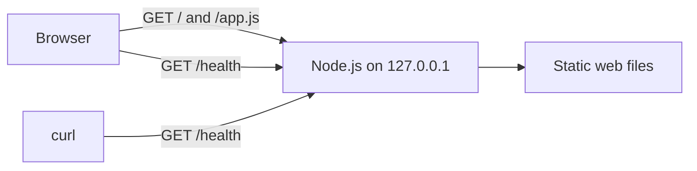

# Architecture

Phase 0 is a local foundation for a small app that will exercise the test infrastructure.

The HTTP adapter in `apps/api/server.js` starts the process and writes HTTP responses. The route function in `apps/api/app.js` chooses the status, headers, and body. Unit tests call it directly without opening a socket. The setup and teardown scripts manage the single process for interactive development.

The frontend requests `/health` on page load and on demand. The health response confirms that the service can answer requests. Phase 0 has no external dependencies to check. The API serves only explicitly mapped web files, and local configuration stays outside the public routes.

Later phases will add a database, a container build, and deployment checks. The planned AWS deployment uses ECS Fargate. The Kubernetes demonstration will run on a local cluster to avoid paying for an EKS control plane.
